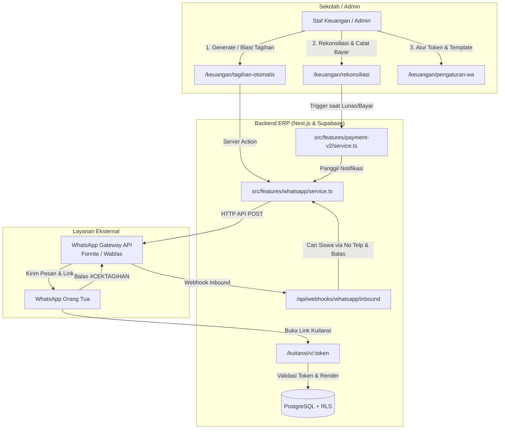

# Rencana Implementasi: WhatsApp Gateway & Otomasi Kuitansi Pembayaran (Issue Planning)

> **Target Pelaksana:** Junior Programmer / Model AI Ekonomis (Cost-effective AI).  
> **Standar & Aturan:** Wajib mematuhi [`AGENTS.md`](file:///d:/Developments/erp-sekolah/AGENTS.md) dan panduan arsitektur di folder `knowledge/` (`knowledge/ARCHITECTURE.md`, `knowledge/design.md`, `knowledge/DATA_MODEL.md`, `knowledge/API.md`).

---

## 1. Ringkasan Fitur & Tujuan

Fitur ini bertujuan untuk mengotomasi alur penagihan dan konfirmasi pembayaran kepada orang tua/wali murid melalui media komunikasi utama mereka, yaitu **WhatsApp (WA)**.

Tiga kapabilitas inti yang akan diimplementasikan:
1. **Blast / Push Tagihan:** Mengirimkan notifikasi tagihan aktif (SPP, uang kegiatan, dll.) beserta rincian biaya, tenggat waktu, dan petunjuk transfer/nomor rekening ke nomor WhatsApp orang tua murid.
2. **Instant Receipt Notification (Kuitansi Otomatis):** Begitu pembayaran dicatat dan diverifikasi (baik manual via rekonsiliasi maupun kelak via payment gateway), sistem secara otomatis mengirimkan pesan konfirmasi pembayaran beserta **tautan kuitansi digital resmi** yang dapat dibuka/dicetak langsung oleh orang tua tanpa perlu login.
3. **Self-Service Status Tagihan (Bot Interaktif Sederhana):** Orang tua dapat mengirim pesan WhatsApp (contoh: `#CEKTAGIHAN` atau `#TAGIHAN`) ke nomor sekolah, dan sistem akan otomatis membalas dengan status serta total tagihan tertunggak anak mereka berdasarkan kecocokan nomor telepon pengirim.

---

## 2. Arsitektur Komponen



---

## 3. Tahap 1: Skema Database & Migrasi SQL

Buat file migrasi baru: `supabase/migrations/0055_whatsapp_gateway.sql`.

> **Aturan Wajib:**
> - Selalu sertakan `school_id references public.schools(id) on delete cascade` di setiap tabel.
> - Tambahkan trigger `set_updated_at` untuk setiap tabel baru yang memiliki `updated_at`.
> - Buat RLS policy lengkap dan index untuk kolom `school_id`.

### 3.1 DDL Migrasi (`0055_whatsapp_gateway.sql`)

```sql
-- =============================================================================
-- Migrasi: WhatsApp Gateway, Log Notifikasi, dan Token Akses Kuitansi Publik
-- =============================================================================

-- 1. Tabel Konfigurasi WhatsApp per Sekolah (Multi-tenant)
create table if not exists public.whatsapp_settings (
    id                  uuid primary key default gen_random_uuid(),
    school_id           uuid not null references public.schools(id) on delete cascade unique,
    provider            text not null default 'fonnte' check (provider in ('fonnte', 'wablas')),
    api_token           text not null default '',
    sender_number       text,
    is_active           boolean not null default false,
    auto_send_invoice   boolean not null default false,
    auto_send_receipt   boolean not null default true,
    template_invoice    text not null default 'Yth. Orang tua dari {{nama_siswa}}, tagihan {{nama_tagihan}} sebesar {{nominal}} telah terbit dengan jatuh tempo {{jatuh_tempo}}. Pembayaran dapat ditransfer ke {{rekening_tujuan}}. Terima kasih.',
    template_receipt    text not null default 'Alhamdulillah, pembayaran {{nama_tagihan}} an. {{nama_siswa}} sebesar {{nominal}} telah kami terima pada {{tanggal_bayar}}. Unduh kuitansi resmi Anda di: {{link_kuitansi}}. Terima kasih.',
    webhook_secret      text default encode(gen_random_bytes(16), 'hex'),
    created_at          timestamptz not null default now(),
    updated_at          timestamptz not null default now()
);

create index if not exists idx_whatsapp_settings_school on public.whatsapp_settings (school_id);

drop trigger if exists trg_whatsapp_settings_updated_at on public.whatsapp_settings;
create trigger trg_whatsapp_settings_updated_at
    before update on public.whatsapp_settings
    for each row execute function public.set_updated_at();

-- 2. Tabel Log Pengiriman Pesan WhatsApp
create table if not exists public.whatsapp_logs (
    id              uuid primary key default gen_random_uuid(),
    school_id       uuid not null references public.schools(id) on delete cascade,
    recipient_phone text not null,
    recipient_name  text,
    message_type    text not null check (message_type in ('invoice', 'receipt', 'reminder', 'bot_inbound')),
    content         text not null,
    status          text not null default 'pending' check (status in ('pending', 'sent', 'failed')),
    response_payload jsonb,
    error_message   text,
    invoice_id      uuid references public.invoices(id) on delete set null,
    payment_id      uuid references public.payments(id) on delete set null,
    student_id      uuid references public.students(id) on delete set null,
    created_at      timestamptz not null default now(),
    updated_at      timestamptz not null default now()
);

create index if not exists idx_whatsapp_logs_school on public.whatsapp_logs (school_id);
create index if not exists idx_whatsapp_logs_created_at on public.whatsapp_logs (school_id, created_at desc);
create index if not exists idx_whatsapp_logs_recipient on public.whatsapp_logs (school_id, recipient_phone);

drop trigger if exists trg_whatsapp_logs_updated_at on public.whatsapp_logs;
create trigger trg_whatsapp_logs_updated_at
    before update on public.whatsapp_logs
    for each row execute function public.set_updated_at();

-- 3. Tabel Token Akses Kuitansi Publik (Tanpa Login)
create table if not exists public.receipt_access_tokens (
    id              uuid primary key default gen_random_uuid(),
    school_id       uuid not null references public.schools(id) on delete cascade,
    payment_id      uuid not null references public.payments(id) on delete cascade,
    token           text not null unique default encode(gen_random_bytes(24), 'hex'),
    expires_at      timestamptz not null default (now() + interval '30 days'),
    view_count      integer not null default 0,
    created_at      timestamptz not null default now()
);

create index if not exists idx_receipt_access_tokens_token on public.receipt_access_tokens (token);
create index if not exists idx_receipt_access_tokens_payment on public.receipt_access_tokens (payment_id);

-- 4. Enable RLS
alter table public.whatsapp_settings enable row level security;
alter table public.whatsapp_logs enable row level security;
alter table public.receipt_access_tokens enable row level security;

-- 5. RLS Policies
-- whatsapp_settings
drop policy if exists whatsapp_settings_select on public.whatsapp_settings;
create policy whatsapp_settings_select on public.whatsapp_settings
    for select to authenticated
    using (
        public.is_super_admin() or (
            public.current_access_ok() and school_id = public.current_school_id()
        )
    );

drop policy if exists whatsapp_settings_modify on public.whatsapp_settings;
create policy whatsapp_settings_modify on public.whatsapp_settings
    for all to authenticated
    using (
        public.is_super_admin() or (
            public.current_access_ok() 
            and school_id = public.current_school_id() 
            and public.has_permission('finance.whatsapp_manage')
        )
    )
    with check (
        public.is_super_admin() or (
            public.current_access_ok() 
            and school_id = public.current_school_id() 
            and public.has_permission('finance.whatsapp_manage')
        )
    );

-- whatsapp_logs
drop policy if exists whatsapp_logs_select on public.whatsapp_logs;
create policy whatsapp_logs_select on public.whatsapp_logs
    for select to authenticated
    using (
        public.is_super_admin() or (
            public.current_access_ok() 
            and school_id = public.current_school_id() 
            and (
                public.has_permission('finance.whatsapp_view') 
                or public.has_permission('finance.whatsapp_manage')
                or public.has_permission('finance.view')
            )
        )
    );

drop policy if exists whatsapp_logs_insert on public.whatsapp_logs;
create policy whatsapp_logs_insert on public.whatsapp_logs
    for insert to authenticated
    with check (
        public.is_super_admin() or (
            public.current_access_ok() 
            and school_id = public.current_school_id()
        )
    );

-- receipt_access_tokens (Hanya insert oleh user berhak finance, select publik via service role)
drop policy if exists receipt_access_tokens_select on public.receipt_access_tokens;
create policy receipt_access_tokens_select on public.receipt_access_tokens
    for select to authenticated
    using (
        public.is_super_admin() or (
            public.current_access_ok() and school_id = public.current_school_id()
        )
    );

drop policy if exists receipt_access_tokens_insert on public.receipt_access_tokens;
create policy receipt_access_tokens_insert on public.receipt_access_tokens
    for insert to authenticated
    with check (
        public.is_super_admin() or (
            public.current_access_ok() and school_id = public.current_school_id()
        )
    );

-- 6. Seed Permissions Baru ke tabel permissions
insert into public.permissions (slug, module, name, description)
values
    ('finance.whatsapp_view', 'finance', 'Lihat WhatsApp & Log', 'Melihat konfigurasi dan log notifikasi WhatsApp'),
    ('finance.whatsapp_manage', 'finance', 'Kelola WhatsApp Gateway', 'Mengatur kredensial API dan template pesan WhatsApp')
on conflict (slug) do nothing;
```

---

## 4. Tahap 2: Registrasi RBAC & Navigasi Sidebar

Ikuti langkah baku penambahan modul sesuai [AGENTS.md](file:///d:/Developments/erp-sekolah/AGENTS.md):

### 4.1 Update `src/lib/rbac.ts`
Tambahkan slug permission pada objek `PERMISSIONS`:
```typescript
// Tambahkan di PERMISSIONS (bagian finance):
financeWhatsAppView: "finance.whatsapp_view",
financeWhatsAppManage: "finance.whatsapp_manage",
```

### 4.2 Update `src/lib/nav.ts`
Tambahkan sub-menu di grup `"keuangan"` atau `"tagihan"`:
```typescript
{
  title: "WhatsApp & Notifikasi",
  href: "/keuangan/pengaturan-wa",
  icon: "keuangan",
  permission: PERMISSIONS.financeWhatsAppView,
  group: "keuangan",
},
```

---

## 5. Tahap 3: Pembuatan Feature Module `src/features/whatsapp/`

Buat folder `src/features/whatsapp/` dengan file-file berikut:

```
src/features/whatsapp/
├── types.ts          # Tipe data WhatsApp provider & payload
├── schema.ts         # Zod schemas & form parsers
├── gateway-client.ts # HTTP client untuk provider (Fonnte & Wablas)
├── service.ts        # Business logic notifikasi & penggantian template
└── service.test.ts   # Vitest unit tests
```

### 5.1 `src/features/whatsapp/types.ts`
```typescript
export type WhatsAppProvider = "fonnte" | "wablas";

export type WhatsAppSettingsRecord = {
  id: string;
  school_id: string;
  provider: WhatsAppProvider;
  api_token: string;
  sender_number?: string | null;
  is_active: boolean;
  auto_send_invoice: boolean;
  auto_send_receipt: boolean;
  template_invoice: string;
  template_receipt: string;
  webhook_secret?: string | null;
};

export type SendWhatsAppMessageParams = {
  school_id: string;
  phone: string;
  message: string;
  messageType: "invoice" | "receipt" | "reminder" | "bot_inbound";
  recipientName?: string;
  invoiceId?: string;
  paymentId?: string;
  studentId?: string;
};
```

### 5.2 `src/features/whatsapp/gateway-client.ts`
Abstraksi pengiriman pesan HTTP:
- **Normalisasi Nomor Telepon:** Format nomor menjadi internasional standar Indonesia (misal `08123...` diubah menjadi `628123...`, hilangkan spasi, strip, dan karakter non-angka).
- **Fonnte API:**
  - Endpoint: `https://api.fonnte.com/send`
  - Headers: `Authorization: <api_token>`
  - Body (JSON / FormData): `{ target: phone, message: message }`
- **Wablas API:**
  - Endpoint: `https://api.wablas.com/api/send-message` (atau domain instance)
  - Headers: `Authorization: <api_token>`
  - Body: `{ phone: phone, message: message }`

### 5.3 `src/features/whatsapp/schema.ts`
Zod schema untuk:
- `saveWhatsAppSettingsSchema`: validasi form token, pilihan provider, dan template string.
- `sendBulkInvoiceWASchema`: validasi pengiriman tagihan masal (`invoice_ids: z.array(z.string().uuid()).min(1)`).

### 5.4 `src/features/whatsapp/service.ts`
Logika inti yang harus dibuat:
1. `getWhatsAppSettings(deps, schoolId)`: Ambil setting sekolah.
2. `saveWhatsAppSettings(deps, current, input)`: Simpan token & konfigurasi dengan sanitasi.
3. `formatTemplate(template, variables)`: Helper mengganti placeholder:
   - `{{nama_siswa}}` → Nama lengkap siswa
   - `{{nama_tagihan}}` → Judul invoice / Skema biaya
   - `{{nominal}}` → `formatRupiah(amount)`
   - `{{jatuh_tempo}}` → Tanggal jatuh tempo terformat
   - `{{rekening_tujuan}}` → Daftar rekening bank sekolah aktif dari tabel `bank_accounts`
   - `{{link_kuitansi}}` → URL public token kuitansi
4. `createReceiptAccessToken(supabaseAdmin, paymentId, schoolId)`: Menghasilkan token acak 48 karakter di tabel `receipt_access_tokens` dan mengembalikan URL kuitansi: `${process.env.NEXT_PUBLIC_APP_URL || ''}/kuitansi/v/${token}`.
5. `sendWhatsAppNotification(deps, params)`: Mengirim via `gateway-client`, lalu mencatat ke `whatsapp_logs`.
6. `triggerReceiptNotification(deps, paymentId, schoolId)`:
   - Ambil data siswa dan no telp wali (`telepon_wali` / `no_telp_wali`).
   - Buat access token kuitansi.
   - Format template kuitansi.
   - Kirim notifikasi WA.

---

## 6. Tahap 4: Integrasi ke Alur Keuangan yang Ada

### 6.1 Integrasi Instant Kuitansi Otomatis di `src/features/payment-v2/service.ts`
Buka file [`src/features/payment-v2/service.ts`](file:///d:/Developments/erp-sekolah/src/features/payment-v2/service.ts).
Pada fungsi `recordInvoicePayment`:
- Setelah `payments` dan `payment_invoices` berhasil dicatat (sebelum `return okResult("Pembayaran berhasil dicatat.")`):
- Panggil fungsi asinkron (non-blocking agar tidak memperlambat respon UI):
  ```typescript
  // Trigger pengiriman WhatsApp kuitansi otomatis di latar belakang
  triggerReceiptNotificationSafe({ supabase }, insertedPayment.id, schoolId).catch((err) => {
    console.error("Gagal mengirim notifikasi WA kuitansi:", err);
  });
  ```

### 6.2 Integrasi Tombol "Kirim WA Tagihan" di Halaman Tagihan
Di halaman [`src/app/(app)/keuangan/tagihan-otomatis/tagihan-otomatis-client.tsx`](file:///d:/Developments/erp-sekolah/src/app/(app)/keuangan/tagihan-otomatis/tagihan-otomatis-client.tsx):
- Tambahkan tombol **"Kirim WA Tagihan"** pada deretan aksi tabel invoice atau menu pemilihan masal (bulk selection).
- Sediakan konfirmasi dialog (`AlertDialog`) yang menampilkan jumlah orang tua yang akan dikirimi notifikasi.
- Buat Server Action `sendBulkInvoiceWAAction` di `actions.ts` yang dilindungi `guardAction(PERMISSIONS.billingManage)`.

---

## 7. Tahap 5: Endpoint Publik Kuitansi Digital Tanpa Login

Orang tua murid yang menerima pesan WA berisi link kuitansi tidak memiliki akun login di sistem ERP. Oleh karena itu, kuitansi harus bisa dibuka melalui **Token Akses Unik**.

### 7.1 Halaman Publik: `src/app/kuitansi/v/[token]/page.tsx`
- Jangan gunakan `requirePermission` di halaman ini (karena ditujukan untuk umum/orang tua).
- Gunakan `createAdminClient()` (karena akses publik membutuhkan bypass RLS terkontrol dengan token rahasia).
- Ambil baris dari tabel `receipt_access_tokens` berdasarkan `token`:
  - Jika token tidak ditemukan atau `expires_at < now()`, tampilkan halaman `notFound()` atau pesan "Tautan kuitansi telah kedaluwarsa".
  - Jika valid, increment `view_count = view_count + 1`.
  - Ambil payment record dan render menggunakan fungsi bawaan template kuitansi:
    `getReceiptRecord` dan `renderReceipt` dari [`src/features/receipt-templates/service.ts`](file:///d:/Developments/erp-sekolah/src/features/receipt-templates/service.ts).
- Tampilkan tombol cetak / download PDF ramah cetak (`print:hidden`).

---

## 8. Tahap 6: Webhook Bot Balasan Otomatis (`#CEKTAGIHAN`)

### 8.1 Route Handler: `src/app/api/webhooks/whatsapp/inbound/route.ts`
Endpoint publik untuk menerima HTTP POST dari gateway WhatsApp ketika ada pesan masuk dari orang tua murid.

**Alur Logika:**
1. **Verifikasi Request:** Cek token/secret header dari gateway.
2. **Ekstrak Data Masuk:** Ambil `sender_phone` dan `message_body`.
3. **Cek Perintah:** Jika pesan mengandung kata kunci `#CEKTAGIHAN` atau `#TAGIHAN`:
   - Bersihkan format nomor pengirim (hilangkan kode negara, cari format lokal atau internasional di kolom `students.telepon_wali` atau `students.no_telp_wali`).
   - Query siswa yang nomor walinya cocok dengan nomor pengirim.
   - Jika siswa tidak ditemukan: balas *"Nomor WhatsApp Anda belum terdaftar di sistem sekolah kami. Silakan hubungi tata usaha untuk pembaruan nomor wali."*
   - Jika siswa ditemukan:
     - Query seluruh invoice siswa yang berstatus `'belum_bayar'` atau `'sebagian'`.
     - Hitung total tunggakan.
     - Buat pesan balasan terstruktur:
       ```
       Rincian Tagihan an. [Nama Siswa] (Kelas [Nama Kelas]):
       1. SPP Oktober 2026: Rp 500.000 (Belum Bayar)
       2. Uang Ujian: Rp 250.000 (Sisa Rp 100.000)
       
       Total Belum Dibayar: Rp 600.000
       
       Pembayaran dapat ditransfer ke:
       - Bank BSI: 7123456789 an. Yayasan Sekolah
       - Bank BCA: 8901234567 an. Yayasan Sekolah
       
       Setelah transfer, bukti akan diverifikasi otomatis oleh sistem. Terima kasih.
       ```
4. Panggil `gateway-client` untuk mengirimkan pesan balasan kembali ke orang tua.
5. Catat log percakapan di `whatsapp_logs` dengan `message_type: 'bot_inbound'`.
6. Return `Response.json({ ok: true })` dengan status 200.

---

## 9. Tahap 7: Halaman UI Pengaturan WhatsApp (`/keuangan/pengaturan-wa`)

Buat halaman di `src/app/(app)/keuangan/pengaturan-wa/`:
- `page.tsx`: Server Component, panggil `requirePermission(PERMISSIONS.financeWhatsAppView)`.
- `actions.ts`: Server Actions (`saveWhatsAppSettingsAction`, `sendTestWhatsAppAction`) dengan `guardAction()`.
- `pengaturan-wa-client.tsx`: Client Component mengikuti standar UI Forest Green:
  - **Tab 1: Konfigurasi Provider & Kredensial:**
    - Pilihan Provider: Radio / Select (`Fonnte`, `Wablas`).
    - Input API Token & Nomor Pengirim.
    - Switch toggle: *Aktifkan Layanan*, *Kirim Kuitansi Otomatis*, *Kirim Tagihan Otomatis*.
    - Tombol "Kirim Pesan Uji Coba" ke nomor admin untuk memverifikasi token bekerja.
  - **Tab 2: Kustomisasi Template Pesan:**
    - Textarea untuk `template_invoice` dan `template_receipt`.
    - Petunjuk daftar variabel tag yang dapat digunakan (`{{nama_siswa}}`, `{{nominal}}`, dll.).
  - **Tab 3: Riwayat Log Pengiriman (Tabel Log):**
    - Tabel dibungkus `Card` dengan `CardContent className="px-0"`.
    - Menampilkan: Tanggal, Penerima, Jenis Pesan, Status (`sent` hijau, `failed` merah), dan pesan error jika gagal.

---

## 10. Panduan Pengujian (Testing Strategy)

### 10.1 Unit Tests (Vitest)
Buat file `src/features/whatsapp/service.test.ts`:
- Test fungsi normalisasi nomor HP (`0812...` → `62812...`).
- Test fungsi penggantian template `formatTemplate` dengan variabel lengkap dan variabel kosong.
- Test pembuatan token kuitansi dan pengecekan masa kedaluwarsa.
- Mock HTTP fetch ke provider WhatsApp untuk memastikan penanganan status 200, 401 (token salah), dan network timeout.

### 10.2 Uji Coba Manual (Manual QA Checklist)
- [ ] Simpan token API WhatsApp dan lakukan tes kirim pesan ke nomor pribadi admin.
- [ ] Catat pembayaran di `/keuangan/rekonsiliasi`, pastikan dalam beberapa detik nomor wali siswa menerima pesan konfirmasi WA.
- [ ] Klik link kuitansi di dalam pesan WA melalui browser mode *incognito*, pastikan kuitansi terbuka dengan tampilan rapi dan tombol cetak berfungsi.
- [ ] Kirim pesan `#CEKTAGIHAN` dari WhatsApp orang tua ke nomor WhatsApp bot sekolah, pastikan sistem membalas dengan daftar tagihan yang benar.
- [ ] Buka tab Riwayat Log di `/keuangan/pengaturan-wa` untuk memastikan semua interaksi tercatat di database.

---

## 11. Urutan Pengerjaan Bertahap (Checklist untuk Junior Programmer / AI)

```
[ ] Langkah 1: Buat migrasi database `supabase/migrations/0055_whatsapp_gateway.sql`.
[ ] Langkah 2: Daftarkan permission di `src/lib/rbac.ts` dan navigasi di `src/lib/nav.ts`.
[ ] Langkah 3: Implementasikan modul `src/features/whatsapp/` (types, schema, gateway-client, service).
[ ] Langkah 4: Buat halaman publik kuitansi `src/app/kuitansi/v/[token]/page.tsx`.
[ ] Langkah 5: Hubungkan trigger kirim kuitansi otomatis di `src/features/payment-v2/service.ts`.
[ ] Langkah 6: Buat endpoint webhook pesan masuk di `src/app/api/webhooks/whatsapp/inbound/route.ts`.
[ ] Langkah 7: Bangun halaman UI konfigurasi & log di `src/app/(app)/keuangan/pengaturan-wa/`.
[ ] Langkah 8: Tambahkan tombol kirim WA masal di `src/app/(app)/keuangan/tagihan-otomatis/`.
[ ] Langkah 9: Jalankan `npm test` dan `npm run build` untuk memverifikasi tidak ada error tipe data atau sintaks.
```
